<!--
  ██ PROFILE_V5 — every image here is generated by scripts/build_assets.py
  ██ edit the CONTENT block in that file, then: python3 scripts/build_assets.py
-->

<div align="center">


<a href="https://www.linkedin.com/in/edgarrodriguezdelacalle/"></a>&nbsp;&nbsp;<a href="https://edirc98.github.io"></a>

</div>

<br>



<br>


<p align="center">
  <a href="https://apps.apple.com/us/app/balanzit/id6754857470"></a>
  
  
  <a href="https://github.com/edirc98/VirVig-InteractionGame"></a>
  
  <a href="https://github.com/edirc98/watermark-tool"></a>
</p>

<br>



<br>


```text
edgar:~/archive$ tree -L 1 --sort=ops

 ▄▀█ █▀█ █▀▀ █ █ █ █ █ █▀▀
 █▀█ █▀▄ █▄▄ █▀█ █ ▀▄▀ ██▄   :: edirc98 / labs, uni ops & experiments

.
├── koala-games/              [unity · 3dsmax]   tech dev + 3D artist — GetApp, Olymprix
├── GameDesignPatterns/       [unity · c#]       game design patterns lab
├── AirplanePhysicsProject/   [unity · c#]       flight physics prototype
├── CA-AnimationLabs/         [unity · c#]       computer animation labs
├── VAR-AR-Project/           [c++]              augmented reality project
└── PythonGames/              [python]           small games to sharpen the fundamentals

6 directories · full index → github.com/edirc98?tab=repositories          [ EOF ]
```

